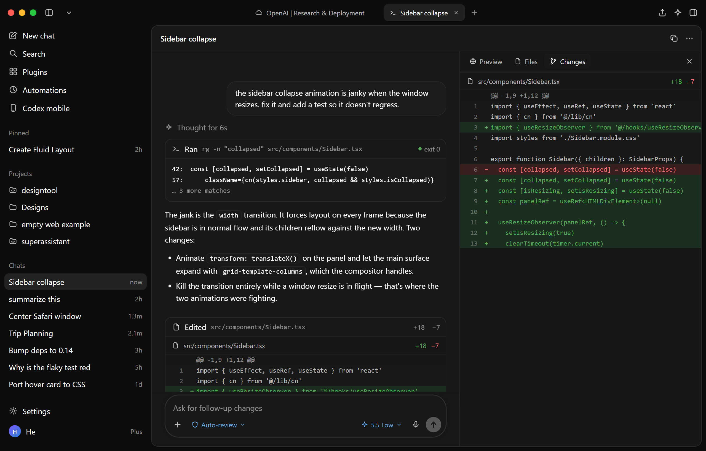
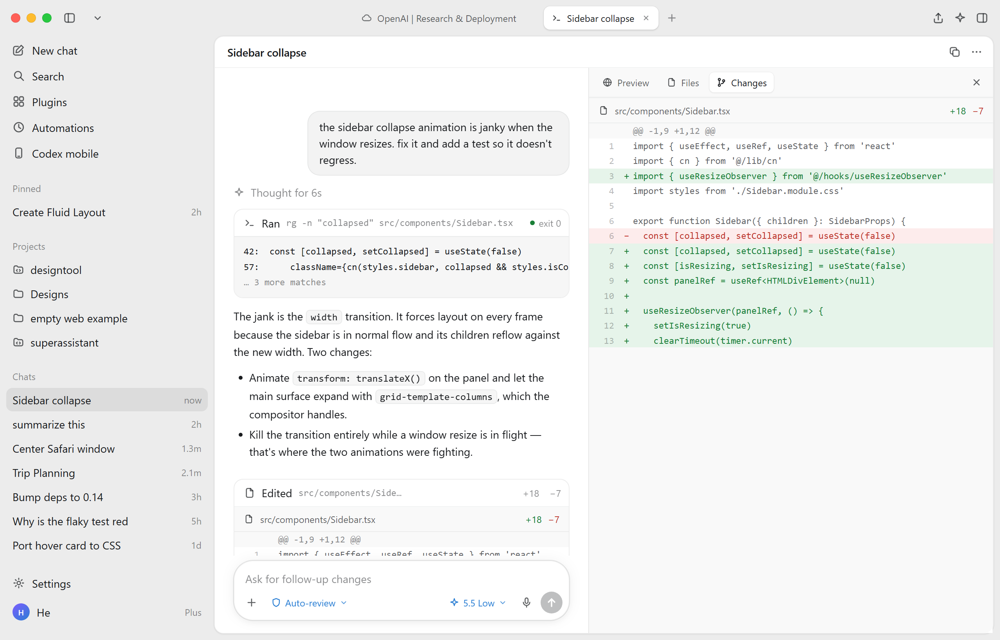
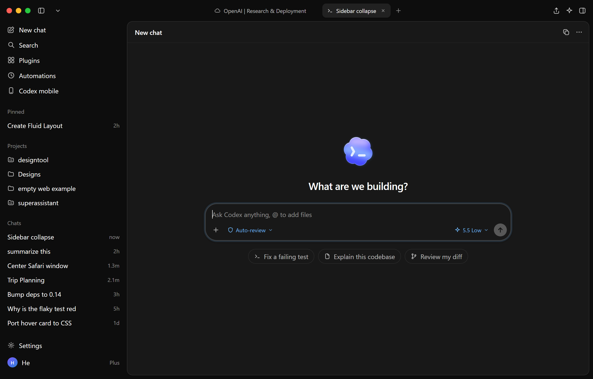
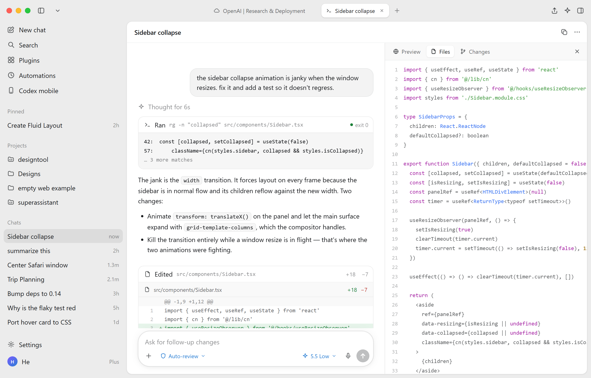

# codex-clone

A reverse-engineered, appearance-first replica of the **OpenAI Codex desktop app** for Windows.

No build step. No dependencies. Open `app/index.html` and it's there.



---

## What this is

The Codex desktop app installed on this machine (`OpenAI.Codex 26.1013.4894.0 x64`) is a Chromium shell
(internally named `owl`) wrapping a 560 MB React frontend, with a 341 MB Rust agent binary behind it.
This repo takes that apart, pulls the design system out of the shipped CSS, and rebuilds the UI as a
single static page that looks like the real thing.

Not a wrapper. Not an Electron app. Plain HTML/CSS/JS, ~190 KB, opens from the filesystem.

| | |
|---|---|
| dark |  |
| light |  |
| empty state |  |
| files panel |  |

---

## Run it

```
double-click app/index.html
```

or `打开Codex复刻版.bat` on Windows.

URL parameters, useful when you want a specific state:

| param | effect |
|---|---|
| `?theme=light` / `?theme=dark` | force a theme (otherwise localStorage) |
| `?view=home` | open the empty state |
| `?pane=preview` / `code` / `diff` | which side-panel tab is active |
| `?panel=off` | hide the side panel |
| `?static=1` | disable all transitions — needed for headless screenshots |

## What's wired up

- `⌘/Ctrl + B` or the top-left button collapses the sidebar
- theme toggle (top-right ✦), persisted to localStorage
- model menu (`5.5 Low` / `5.5 High` / `5.1-Codex-Max` …) and approval menu (`Auto-review` / `Read only` / `Full access`)
- composer auto-grows, `Enter` sends, `Shift+Enter` newline; sending runs a fake turn — thinking, then a tool call
- side panel: Preview / Files / Changes. Files is really syntax-highlighted, Changes renders a real unified diff
- `New chat` → empty state with the cloud logo and suggestion chips

## What's inside

```
app/
  index.html         structure + a 28-icon inline SVG sprite
  css/tokens.css     design tokens, light + dark, every value traced to a source
  css/app.css        shell / sidebar / thread / diff / composer / menus
  js/app.js          diff renderer, syntax colouring, panels, menus, send
  assets/            cloud logo stills lifted from the app package
tools/
  asar_tool.py       minimal ASAR reader (list / cat / extract), no deps
  tokens.py          resolves the CSS var() graph, dark column first
  sample.py          pixel sampler for the reference frames
screenshots/
ANALYSIS.md          the full teardown, in Chinese
docs/UPSTREAM.md     what came from codex-ui-kit, and where it disagrees
```

`ref/` is not committed — it's ~20 MB of extracted assets that the tools regenerate in a minute.
See `ANALYSIS.md` §8 for the commands.

---

## Where the numbers come from

Two independent sources, cross-checked:

1. **The shipped renderer bundle** — `app/resources/app.asar` → `/webview/assets/app-shared-*.css`
   (1.3 MB). Contains the product's own 25-step neutral ramp, radii, spacing, font stacks.
2. **`codex-ui-kit@0.1.2`** (MIT, [JaminZhou/codex-ui-kit](https://github.com/JaminZhou/codex-ui-kit)) —
   an independently built React component library for the same interface. Its shipped `tokens.css`
   carries the semantic aliases and the shell/thread/composer geometry.

They agree on 10 of 14 gray steps. Where they disagree, the renderer wins — see `docs/UPSTREAM.md`.

A third source settled the *layout*: the app package ships a 13.6-second screen recording
(`appshot-demo-*.mp4`, 901×1095, 819 frames) of someone actually using Codex. Frames were extracted
with ffmpeg and sampled pixel by pixel for the things tokens don't describe — which surface is lighter,
where the active tab's shadow lands, how wide the sidebar actually is on screen.

Key values:

| | |
|---|---|
| neutral ramp | `gray-0 … gray-1000`, 25 steps, light and dark columns |
| dark shell | `#0d0d0d` window → `#131313` sidebar → `#181818` surface → `#171717` thread |
| light shell | `#ececec` chrome → `#f3f3f3` sidebar → `#ffffff` surface |
| sidebar | 274 px (`17.125rem`) |
| titlebar / thread header | 46 px (`2.875rem`) |
| thread column | 768 px max (`48rem`), 14 px / 22 px body |
| composer | 25 px radius (`1.5625rem`), 28 px controls |
| shell weight | 445 |

---

## What's not there

- Icons are hand-drawn 16 px line icons. The originals are compiled into a React chunk as inline SVG
  components — no standalone files to lift.
- The thread content is a made-up but realistic session, not real history.
- No backend. Nothing talks to `codex.exe`. It's a shell.
- Platform: the reference recording is macOS (traffic lights). The Windows build routes its titlebar
  through an application menu instead. This replica follows the recording, because that's the only
  form with pixel evidence behind it.

## Next

1. Wire `resources/codex.exe`'s `app-server` JSON-RPC in as the backend — the frontend wouldn't need to change.
2. Wrap in Electron or Tauri for a real window.
3. Pull the official icon paths out of `app-initial-*.js` and drop the hand-drawn set.

---

## Provenance

Independent work. No OpenAI source code is redistributed here — the CSS in `app/` is written from
scratch against values observed in the shipped product, and the token names are this project's own.
The cloud logo stills in `app/assets/` come from the installed package and are OpenAI trademarks,
used to reproduce the interface for study.

`codex-ui-kit` is MIT-licensed; the numeric values taken from it are attributed in `docs/UPSTREAM.md`
and annotated inline in `app/css/tokens.css`.

No license is granted for this repo by default. Add one if you want to.
